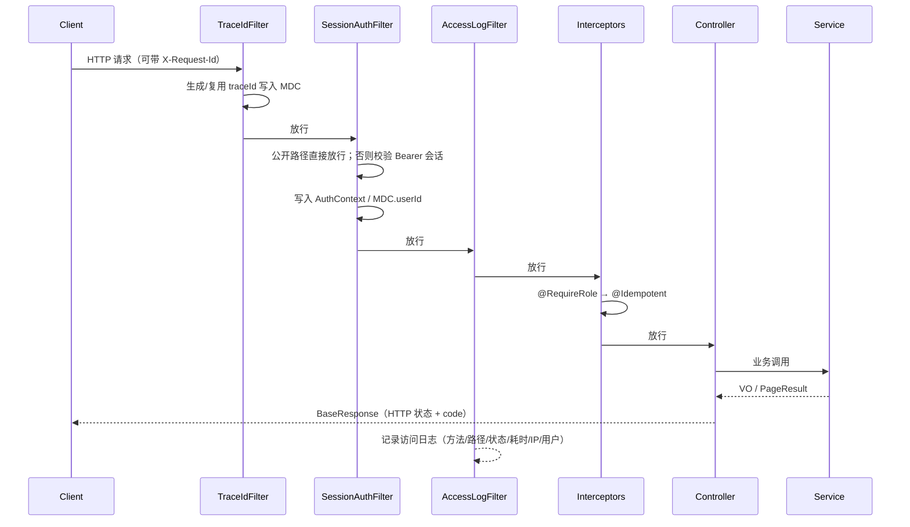

# 架构说明

## 1. 定位与边界

`media-gateway` 是**视频数据网关**的通用脚手架：

- **做什么**：提供网关系统必备的工程能力（统一响应、异常、鉴权、持久层规范、幂等、链路日志、外部调用、容器化、测试与规范）。
- **不做什么**：不含 ZLMediaKit 协议、流/设备/录像模型、业务台账业务逻辑、WVP-PRO 业务实现。
- **怎么扩展**：业务模块按 [adding-a-module.md](adding-a-module.md) 增量添加；脚手架本身保持业务无关。

## 2. 总体结构

```mermaid
graph TD
    subgraph 客户端
        ADMIN[管理端 / 运维脚本]
        BIZ[业务系统]
        ZLM[ZLMediaKit 钩子]
    end

    subgraph media-gateway["media-gateway (Spring Boot 3.3.5)"]
        FILTER[过滤器链<br/>TraceId → SessionAuth → AccessLog]
        MVC[Spring MVC<br/>Controller / 拦截器]
        SVC[Service<br/>业务编排 / 事务]
        MAPPER[Mapper<br/>MyBatis-Plus]
        EXT[ExternalHttpClient<br/>上游 REST 调用]
        SCHED[@Async / @Scheduled]
    end

    subgraph 数据层
        PG[(PostgreSQL 14)]
        REDIS[(Redis / Valkey)]
    end

    ADMIN --> FILTER
    BIZ --> FILTER
    ZLM -.->|后续新增 Webhook 模块| FILTER
    FILTER --> MVC --> SVC --> MAPPER --> PG
    SVC --> REDIS
    SVC --> EXT
    SVC --> SCHED
    EXT --> ZLM
```

## 3. 分层与依赖规则

| 层 | 包 | 职责 | 允许依赖 |
|---|---|---|---|
| Web 入口 | `controller` | 参数接收、校验、编排、返回统一响应 | service、common |
| 业务层 | `service`（含 `module/*/service`） | 业务规则、事务、查询组合、缓存 | mapper、integration、common、security |
| 数据访问 | `mapper` / `entity` | MyBatis-Plus CRUD 与实体映射 | MyBatis-Plus |
| 传输对象 | `dto` / `module/*/dto` | request / query / vo | common |
| 通用基础 | `common` | 响应、异常、幂等、Web 基础设施、工具 | 无业务依赖 |
| 安全 | `security` / `service`（会话） | 会话、令牌、角色、上下文 | common |
| 配置 | `config` | 属性绑定、线程池、RestTemplate、MyBatis-Plus | 无业务依赖 |
| 外部集成 | `integration` | 上游 HTTP 封装 | common |

**规则**：

- `controller` 禁止直接依赖 `mapper`。
- `entity` 禁止出现在公共接口返回值中，统一转 VO。
- `common` 禁止反向依赖业务模块。
- 业务模块之间通过 service 或领域事件协作，禁止跨模块直接访问 mapper。

## 4. 请求处理链路



- 过滤器顺序：`TraceIdFilter(0)` → `SessionAuthFilter(1)` → `AccessLogFilter(2)`。
- 拦截器顺序：`RoleCheckInterceptor(0)` → `IdempotentInterceptor(1)`。
- 异常统一由 `GlobalExceptionHandler` 转换：4xx 只记 warn、5xx 记 error，对外不泄露内部细节。

## 5. 关键组件

| 组件 | 位置 | 说明 |
|---|---|---|
| 统一响应 | `common/api/BaseResponse` | `code/message/data/extra` |
| 分页 | `common/api/PageResult`、`PageQuery` | 分页字段与 items 同级，越界收敛 |
| 错误码 | `common/error/ErrorCode` | 与 HTTP 状态对齐，业务扩展 10000+ |
| 全局异常 | `common/web/GlobalExceptionHandler` | 参数校验、类型、JSON、404/405、业务、兜底 500 |
| 链路追踪 | `common/web/TraceIdFilter` | `X-Request-Id` 读写 + MDC |
| 访问日志 | `common/web/AccessLogFilter` | 方法/路径/状态/耗时/IP/用户 |
| 会话鉴权 | `security/SessionAuthFilter`、`service/SessionService` | Redis 会话，滑动过期 |
| 角色校验 | `security/RoleCheckInterceptor`、`@RequireRole` | 方法级优先于类级 |
| 认证上下文 | `security/AuthContext` | ThreadLocal，业务读取当前用户 |
| 口令哈希 | `security/PasswordHasher` | PBKDF2-HMAC-SHA256，常量时间比较 |
| 幂等 | `common/idempotent/*` | Redis SETNX + `Idempotency-Key` |
| 持久层基类 | `persistence/BaseEntity` | 物理主键 + 审计字段 + 逻辑删除 |
| 审计填充 | `persistence/AuditMetaObjectHandler` | create/update time/by |
| 外部调用 | `integration/ExternalHttpClient` | 超时、traceId、上游错误映射 502 |
| 异步 | `config/AsyncConfig` | 命名线程池 + MDC 透传 |

## 6. 配置与外部覆盖

- 配置前缀：`mgw.*`；应用配置在 `src/main/resources/application.yml`。
- jar 同级 `config/application.yml` 通过 `spring.config.import` 合并，优先级更高。
- 生产敏感项通过环境变量注入（`MGW_DB_*`、`SPRING_DATA_REDIS_PASSWORD` 等）。
- 登录账号在 `mgw.security.users` 中配置；生产务必覆盖默认口令或替换 `AuthService`。

## 7. 日志与链路

- 日志格式（console/file）包含 `traceId`、`userId`，见 `logback-spring.xml`。
- 所有请求响应头回写 `X-Request-Id`；调用上游时自动透传。
- `@Async` 线程通过 `TaskDecorator` 复制 MDC，异步日志仍可关联链路。
- 访问日志不记录请求体与令牌；业务日志禁止输出敏感信息。

## 8. Redis 使用约定

| 用途 | Key 格式 | TTL |
|---|---|---|
| 会话 | `mgw:session:{token}` | `mgw.security.session.ttl-seconds`（默认 7200s，访问续期） |
| 幂等 | `mgw:idem:{subject}:{method}:{path}:{key}` | `@Idempotent.ttlSeconds()`（默认 300s） |

- 统一通过 `common/util/RedisKey` 构造，禁止硬编码。
- 新增缓存必须同时定义失效策略。

## 9. 安全模型

- 会话令牌为 128 位随机会话 ID（非 JWT），服务端可即时吊销。
- 登录失败统一返回“用户名或密码错误”，不区分账号是否存在。
- 口令仅以 PBKDF2 哈希形式存在配置/存储中，明文不落库、不落日志。
- 角色为平台通用能力（ADMIN / OPERATOR / VIEWER），业务模块通过注解引用。

## 10. 扩展点

| 扩展点 | 建议实现方式 |
|---|---|
| 新业务模块 | 复制 `module/demo`，按 [adding-a-module.md](adding-a-module.md) |
| 统一身份系统 | 替换 `AuthService` 的账号来源，会话链路不变 |
| 入站 Webhook（ZLM 钩子等） | 新增公开 controller + 验签 + 幂等 + 原始报文落表 + 异步处理 |
| 出站 Webhook | 订阅表 + `@Scheduled` 投递 + 退避重试 + 死信；多实例需分布式锁 |
| 操作日志 | `@Async` 落 `t_operation_log`，或 AOP 拦截 |
| 定时任务 | `@Scheduled` 已在 `AsyncConfig` 启用；多实例需分布式锁 |

## 11. 部署形态

- 单实例：`java -jar` + 本地 PostgreSQL/Redis。
- 容器：`docker compose up -d --build`（含 PostgreSQL、Redis、应用）。
- 多实例：无状态应用 + 共享 PostgreSQL/Redis；定时任务与 Webhook 投递需引入分布式锁（后续）。
